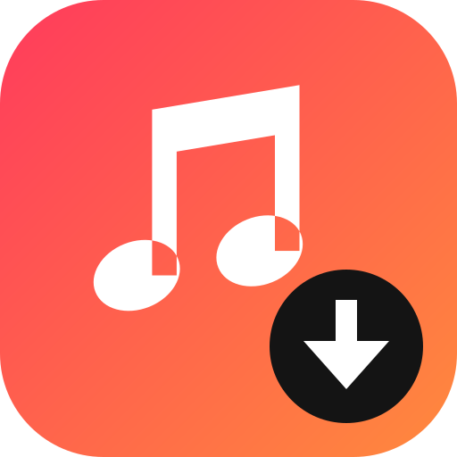

<p align="center"></p>

<h1 align="center">Music Playlist Downloader</h1>

<p align="center">Télécharge toutes les musiques d'une playlist <b>YouTube Music</b> dans le dossier de ton choix, sur <b>ordinateur</b> ou <b>téléphone</b>. Tout tourne en local, sans compte ni serveur.</p>

- Titre, artiste, album et pochette ajoutés aux fichiers
- **Seulement les nouvelles musiques** : se souvient de ce qui a déjà été téléchargé pour chaque playlist et ne récupère que les nouveautés. Si l'option est désactivée, toute la playlist est retéléchargée.
- Appli Android : « Partager » un lien depuis YouTube Music l'ouvre directement dans l'appli

## Installation

| Appareil | Fichier | |
|---|---|---|
| **Android** | [PlaylistDownloader.apk](https://github.com/Kudozu/music-playlist-downloader/releases/latest/download/PlaylistDownloader.apk) | Appli autonome, pas besoin de PC |
| **Windows** | [MusicPlaylistDownloader.exe](https://github.com/Kudozu/music-playlist-downloader/releases/latest/download/MusicPlaylistDownloader.exe) | Double-clic, rien d'autre à installer |
| **Windows** (si l'exe est bloqué) | [MusicPlaylistDownloader-Windows.zip](https://github.com/Kudozu/music-playlist-downloader/releases/latest/download/MusicPlaylistDownloader-Windows.zip) | Extraire, puis double-clic sur `Lancer.bat` |
| **iPhone** | aucun | Ouvre l'appli du PC en scannant le QR code affiché dans sa page |

### Android

1. Ouvre le lien de l'APK sur le téléphone et télécharge-le.
2. Ouvre le fichier. Si Android le demande, autorise ton navigateur à **installer des applis inconnues**. Si Play Protect affiche un avertissement, choisis **Installer quand même** : l'APK n'est pas publié sur le Play Store.
3. Au premier lancement, autorise **l'accès à tous les fichiers** : c'est ce qui permet d'enregistrer les musiques dans le dossier choisi (Music par défaut). Le premier démarrage prend quelques secondes.

Les téléchargements continuent écran éteint. La notification permet de **quitter** l'appli.

### Windows

- Si Windows affiche « Windows a protégé votre ordinateur » : *Informations complémentaires → Exécuter quand même* (l'exe n'est pas signé).
- Si Windows indique « Une stratégie de contrôle d'application a bloqué ce fichier » (Contrôle intelligent des applications de Windows 11), prends la version zip. Elle installe Python toute seule s'il manque.
- Si Windows demande l'accès réseau, coche **Réseaux privés** : c'est ce qui permet d'ouvrir l'appli depuis un téléphone (QR code dans la page).

yt-dlp se met à jour tout seul, sur PC comme sur Android.

## Utilisation

1. Colle le lien de la playlist (`https://music.youtube.com/playlist?list=...`). Elle doit être publique ou non répertoriée.
2. Choisis le dossier de destination.
3. Active ou non **Seulement les nouvelles musiques**, puis appuie sur **Télécharger**.

**Oublier**, dans *Playlists mémorisées*, remet la mémoire d'une playlist à zéro.

## Développement

```bash
pip install -r requirements.txt imageio-ffmpeg
python app.py
```

- `android-app/` contient l'appli Android : Kotlin + WebView, avec le même `app.py` exécuté par [Chaquopy](https://chaquo.com/chaquopy/).
- `tools/make_icons.py` génère le logo et toutes les icônes à partir d'une seule définition vectorielle.
- Pour publier une version : `git tag v1.2.0 && git push origin v1.2.0`. GitHub Actions construit l'exe et l'APK, teste l'APK sur un émulateur Android, puis publie la release.

---

Pour un usage personnel. Respecte les droits d'auteur et les conditions d'utilisation de YouTube.
